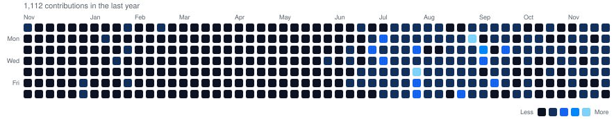

 

<picture>
  <source media="(prefers-color-scheme: dark)" srcset="https://raw.githubusercontent.com/rencaldas/rencaldas/output/github-contribution-grid-dark.svg" />
  <source media="(prefers-color-scheme: light)" srcset="https://raw.githubusercontent.com/rencaldas/rencaldas/output/github-contribution-grid.svg" />
  
</picture>

  

&nbsp;
&nbsp;
&nbsp;
&nbsp;
&nbsp;
&nbsp;

## About Me

I am Renato de Azevedo Caldas, a 21-year-old Systems Analyst intern in Rio de Janeiro focused on building enterprise software that improves operations through cloud, automation, backend development, and systems integration.

I study Computer Science at UVA - Veiga de Almeida University, with graduation expected in 2027, and I enjoy turning business requirements into reliable technical solutions for internal teams and production environments.

## 🛠️ Tech Stack

<table>
  <tr>
    <td width="200"><strong>Programming &amp; Web Development</strong></td>
    <td>
      
      
      
      
      
       Python · JavaScript · HTML5 · CSS3 · Django
    </td>
  </tr>
  <tr>
    <td width="200"><strong>Cloud</strong></td>
    <td>
      
      
      
      
      
      
      
      
       AWS · S3 · EC2 · Lambda · SES · Amplify · Oracle Cloud · Vercel
    </td>
  </tr>
  <tr>
    <td width="200"><strong>Databases</strong></td>
    <td>
      
      
      
      
      
       PostgreSQL · Supabase · MySQL · DBeaver · MySQL Workbench
    </td>
  </tr>
  <tr>
    <td width="200"><strong>Automation &amp; Integration</strong></td>
    <td>
      
      
      
      
       n8n · REST APIs · Postman · Webhooks
    </td>
  </tr>
  <tr>
    <td width="200"><strong>Containers &amp; DevOps</strong></td>
    <td>
      
      
      
       Docker · Git · GitHub
    </td>
  </tr>
  <tr>
    <td width="200"><strong>Enterprise Systems</strong></td>
    <td>
      
      
       SAP ERP · Sankhya ERP
    </td>
  </tr>
  <tr>
    <td width="200"><strong>Data Analysis</strong></td>
    <td>
      
      
       Power BI · Microsoft Office
    </td>
  </tr>
  <tr>
    <td width="200"><strong>Infrastructure</strong></td>
    <td>
      
      
      
      
       Linux · Windows · Hardware · Networking
    </td>
  </tr>
  <tr>
    <td width="200"><strong>UX/UI Design</strong></td>
    <td>
      
      
       Figma · Adobe XD
    </td>
  </tr>
  <tr>
    <td width="200"><strong>Methodologies</strong></td>
    <td>
      
      
       GitHub Spec Kit · Spec-Driven Development
    </td>
  </tr>
</table>

---

&nbsp;
&nbsp;
&nbsp;
&nbsp;
&nbsp;
&nbsp;

